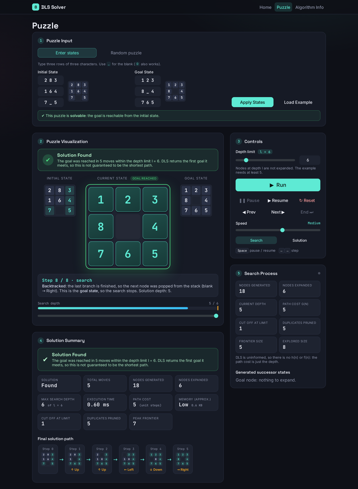
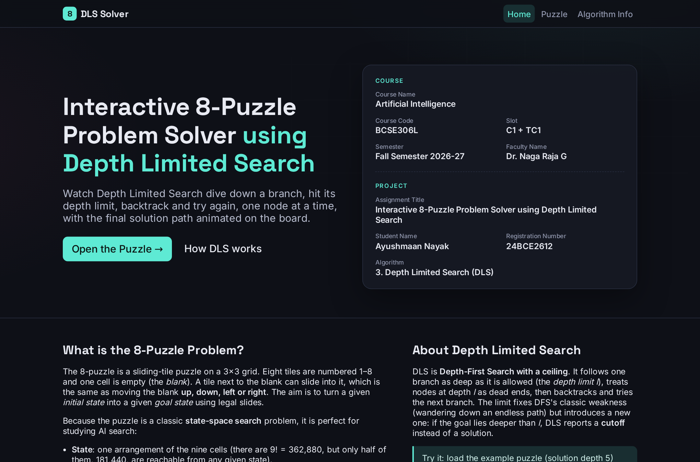
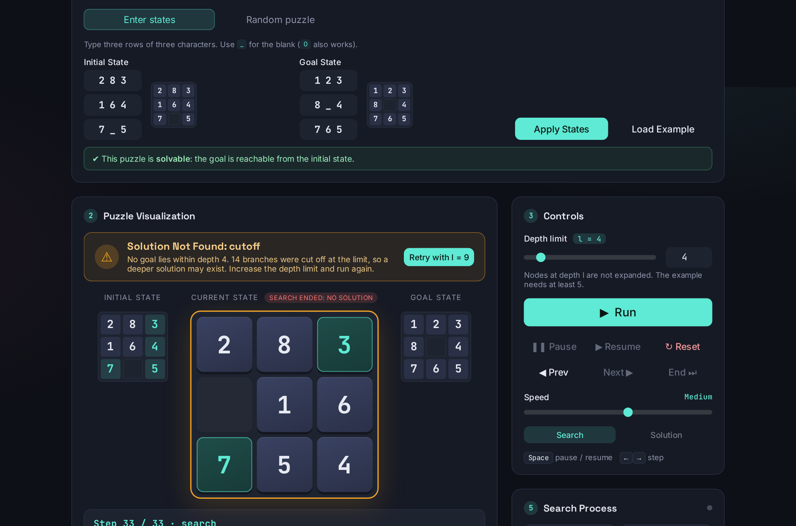
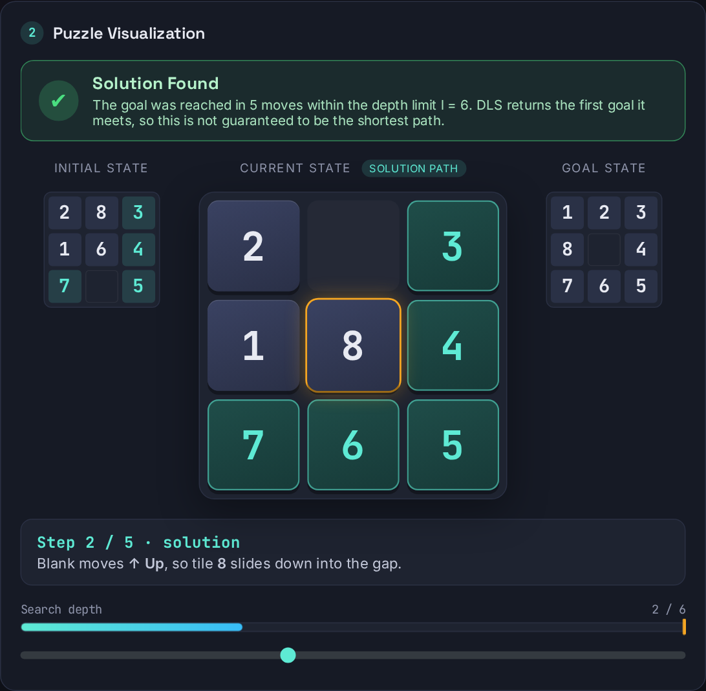
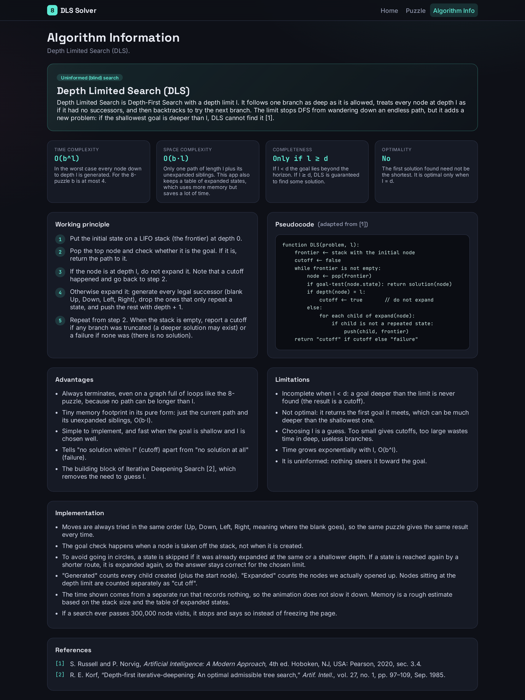

# AI-8Puzzle-Visualizer

**Interactive 8-Puzzle Problem Solver using Depth Limited Search (DLS)**

### 🔗 [Open the live site: https://github.com/ayushmaannayak123/8-Puzzle-Solver)

An interactive web application that solves the classic 8-Puzzle with **Depth Limited Search**, implemented from scratch in JavaScript, and shows the search happening live: the nodes generated and expanded, the successors it generates, the frontier and explored sizes, the depth limit being hit, backtracking, and finally the animated solution path.

| | |

| **Live site (GitHub Pages)** | (https://ayushmaannayak123.github.io/8-Puzzle-Solver/) |
| **Repository** | https://github.com/ayushmaannayak123/8-Puzzle-Solver |



---

## Student Details

| | |
|---|---|
| Name | Ayushmaan Nayak |
| Registration Number | 24BCE2612 |
| Course | Artificial Intelligence |
| Course Code | BCSE306L |
| Slot | C1 + TC1 |
| Semester | Fall Semester 2026-27 |
| Faculty | Dr. Naga Raja G |
| Assignment | Interactive 8-Puzzle Problem Solver using Depth Limited Search |
| Algorithm | **3. Depth Limited Search (DLS)** |

---

## Project Description

The 8-puzzle is a 3×3 sliding-tile puzzle: eight numbered tiles and one blank. It is modelled here as a state-space search problem:

| Element | Definition |
|---|---|
| State | an arrangement of the nine cells |
| Initial / goal state | chosen by the user, or a random solvable puzzle |
| Actions | move the blank **Up, Down, Left, Right** (when it stays on the board) |
| Step cost | 1, so path cost g(n) = depth |
| Goal test | current arrangement equals the goal arrangement |

**Depth Limited Search** is Depth-First Search with a ceiling *l*. Nodes at depth *l* are not expanded. The search ends with one of three outcomes (Russell & Norvig, Fig. 3.17):

* **solution**: a goal was reached within the limit
* **cutoff**: no solution found, but some branch was truncated, so a deeper solution may exist
* **failure**: nothing was truncated, so no solution exists

## Features

**Set up the puzzle**
* Type your own initial and goal states as three rows of three characters (for example `283 / 164 / 7_5`). `_` or `0` is the blank, and a live preview board updates as you type.
* Clear error messages for bad input (wrong length, invalid character, duplicate or missing tile).
* Or generate a **random solvable puzzle**. It is built by scrambling the goal with legal moves, so it can always be solved.
* **Solvability check** before any search, with an explanation when a puzzle is impossible.
* One-click **Load Example** (`283/164/7_5` to `123/8_4/765`).

**Run Depth Limited Search**
* Adjustable **depth limit** from 0 to 200 (slider and number box).
* DLS written from scratch with an explicit stack; successors are always tried in the order Up, Down, Left, Right, so a run is fully repeatable.
* Repeated states are pruned with a depth-aware closed table, and a 300,000-visit safety cap means the page can never freeze.

**Watch the search happen**
* **Animated board:** tiles slide into the blank, the moved tile is highlighted, and tiles already in their goal position turn teal.
* Every step explains itself in plain words: going deeper, backtracking, cutting off at the limit, or reaching the goal.
* **Depth gauge** showing the current depth against the limit.
* **Generated successor states** for each expanded node, each marked as pushed onto the stack or discarded as a repeat.
* **Live counters:** nodes generated, nodes expanded, current depth, path cost g(n), nodes cut off at the limit, duplicates pruned, frontier size and explored size.

**Clear result at a glance**
* A **result banner** above the board shows *Searching...* while the replay runs, then a verdict with an explanation: **Solution Found**, **cutoff** (the limit was too small), **failure** (no solution exists) or **aborted** (safety cap reached).
* The board outline changes colour to match (green, amber or red).
* On a cutoff, a **Retry with a larger limit** button re-runs the search for you.
* **Solution summary:** moves, nodes generated and expanded, maximum depth reached, execution time, path cost, approximate memory (Low / Medium / High), nodes cut off, duplicates pruned and peak frontier.
* **Final solution path** shown as a strip of boards; click any step to jump to it.

**Full playback control**
* Run, Pause, Resume, Prev, Next, End and Reset buttons.
* 10-level **speed** slider and a **scrubber** to drag through any step of the search.
* Switch between the **Search** replay and the **Solution** playback. When a goal is found, the animation moves on to the solution path automatically.
* Keyboard shortcuts: `Space` to pause or resume, `←` and `→` to step.

**Algorithm Info page**
* Description, working principle, pseudocode, advantages and limitations, time and space complexity, completeness and optimality, implementation notes and IEEE-style references.

**Under the hood**
* Dark, responsive design that works on desktop and phones, with accessible labels and reduced-motion support.
* No build step and no server needed: Bootstrap and fonts are bundled locally, so the site also works offline.
* 18 automated tests for the puzzle utilities and the DLS engine.

## Technologies Used

* **HTML5**
* **CSS3** (custom dark design system layered on Bootstrap)
* **JavaScript (ES6)**, vanilla, no build step, no search or AI libraries
* **Bootstrap 5.3** (UI framework: grid, navbar, forms, tabs, tables), vendored in `assets/vendor/`
* Fonts (Space Grotesk, Inter, JetBrains Mono) bundled locally in `assets/fonts/`, so the site works offline

## Search Algorithm Implemented

**Depth Limited Search (DLS)**, in [`js/dls.js`](js/dls.js).

* Explicit **LIFO stack** frontier (no recursion, so it can be recorded and replayed step by step)
* Successors generated in the fixed order **Up, Down, Left, Right** (stack filled in reverse so *Up* is explored first)
* Goal test on pop; nodes at depth *l* are cut off, not expanded
* **Repeated states** are handled with a depth-aware closed table: a state is skipped if it was already expanded at the same or a *shallower* depth. A state reached again at a strictly shallower depth is expanded again, so DLS stays correct within the limit.
* Browser-safety cap of 300,000 node visits; a run that hits it is reported as *aborted*, never as a false "no solution"

| Property | Value |
|---|---|
| Time | O(b^l) |
| Space | O(b·l) for the search itself (plus the closed table) |
| Complete | No, only if l ≥ d |
| Optimal | No |

## Heuristics Used

**None. DLS is an uninformed (blind) search**, so heuristics (Misplaced Tiles, Manhattan Distance) and the values h(n) / f(n) do not apply to it. The guidelines ask for them only for GBFS and A\*, which are not part of this assignment. The path cost g(n) is shown (it equals the depth).

## Screenshots

| Home | Puzzle page (search trace) |
|---|---|
|  |  |

| Cutoff when the limit is too small | Solution playback |
|---|---|
|  |  |

| Algorithm information |
|---|
|  |

## GitHub Pages URL

https://ayushmaannayak123.github.io/AI-8Puzzle-Visualizer/

## Repository Structure

```
AI-8Puzzle-Visualizer/
│── index.html
│── css/style.css
│── js/
│   ├── config.js          student details
│   ├── puzzle.js          state model, parsing, solvability, random puzzles
│   ├── dls.js             Depth Limited Search engine (from scratch)
│   ├── algoInfoData.js    content of the Algorithm Information page
│   ├── visualization.js   animated board, playback, stats, result banner
│   └── main.js            routing and event wiring
│── assets/                Bootstrap + fonts (vendored)
│── images/                screenshots
│── tests/dls.test.js      automated tests
│── docs/                  case-study report
│── README.md
```

## Implementation Notes

* **Solvability** is checked before any search. For a 3×3 board a goal is reachable iff the tile permutation (blank ignored) has even parity; this works for *any* goal state.
* **Random puzzles** are produced by scrambling the *goal* with legal moves (8–20 moves), so they are solvable by construction.
* **Definitions**: *Nodes generated* = every successor created plus the root; *Nodes expanded* = nodes whose successors were generated; nodes popped at depth *l* are reported separately as *cut off*.
* **Execution time** is measured on a run that records nothing; the identical deterministic run is then repeated with recording for the animation.
* **Memory** is approximate: (peak frontier + path) × 32 B + closed-table entries × 24 B.
* **Verification**: DLS was cross-checked against an independent exhaustive table of all 181,440 reachable states over 1,200 runs (found ⇔ limit ≥ shortest depth, never shorter than optimal, cutoff otherwise) with zero mismatches.

## References

[1] S. Russell and P. Norvig, *Artificial Intelligence: A Modern Approach*, 4th ed. Hoboken, NJ, USA: Pearson, 2020, sec. 3.4.

[2] R. E. Korf, "Depth-first iterative-deepening: An optimal admissible tree search," *Artif. Intell.*, vol. 27, no. 1, pp. 97–109, Sep. 1985.

[3] Bootstrap Team, "Bootstrap v5.3 documentation." getbootstrap.com. Accessed: Oct. 23, 2026. [Online]. Available: https://getbootstrap.com

[4] Fontsource, "Space Grotesk, Inter and JetBrains Mono (SIL Open Font License)." fontsource.org. Accessed: Oct. 23, 2026. [Online]. Available: https://fontsource.org

[5] Mozilla, "MDN Web Docs: JavaScript and CSS references." developer.mozilla.org. Accessed: Oct. 23, 2026. [Online]. Available: https://developer.mozilla.org

## Academic Integrity

All search logic, puzzle utilities and UI code in this repository were written for this assignment. Third-party resources are limited to Bootstrap and the web fonts credited above.
